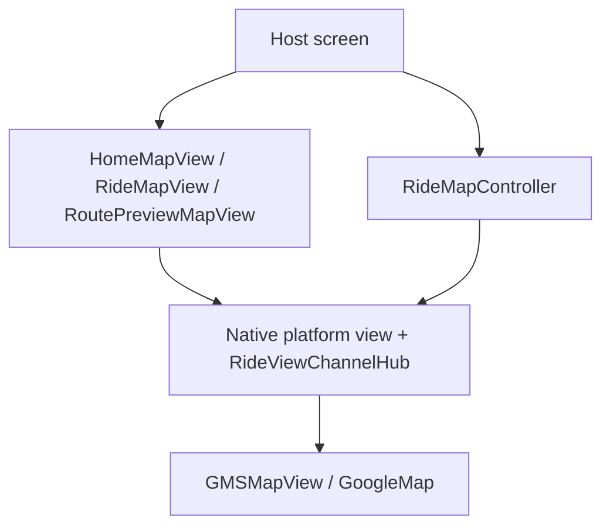

# Architecture

## Layers

| Layer | Location | Responsibility |
|-------|----------|----------------|
| Dart widgets | `lib/src/widgets/` | Thin `PlatformMapView` wrappers; `RideMapView` syncs `mode` to native |
| Controller | `lib/src/controller/ride_map_controller.dart` | Typed method-channel API |
| Bridge | `RideViewChannelHub`, `GoogleMapsPlugin`, `GlobalFlutterBridge` | Owns channels, validates args, `dispose()` cleanup |
| Native map | `Ride/RideMapPlatformView.swift`, `ride/RideMapPlatformView.kt` | Single in-trip map for all `RideMapMode` values |

## Unified in-trip map

All trip stages share **one** native platform view (`hovr-ride-map-view`). Stage changes are driven by:

1. Initial `creationParams['mode']` when the widget is first built.
2. Automatic sync when `RideMapView.mode` changes (`trip-stage` channel) — no extra host wiring.

Legacy view types (`meet-at-pickup-spot-view`, `google-map-view`) register the same factory for migration.

## Surfaces

| Surface | View type | Purpose |
|---------|-----------|---------|
| Home | `home-view-google-map` | User location, nearby drivers |
| Ride | `hovr-ride-map-view` | In-trip map (all modes) |
| Route preview | `routes-on-map-view` | Pickup → dropoff preview |

Pickup location picker (`pickup_location_map`) stays in the host app.
